# DevOps Learning Roadmap (S01 – S66)

> **Mục đích:** Nguồn sự thật toàn diện về toàn bộ lộ trình đào tạo kỹ sư DevOps, định hướng trang bị năng lực thực chiến đạt chuẩn tuyển dụng **DevOps Intern / Fresher / Junior DevOps**.
> **Cấu trúc:** 12 giai đoạn từ nền tảng Linux đến Production Capstone & Job Readiness.

---

## 1. Bản đồ Tổng quan 12 Giai đoạn

```mermaid
flowchart LR
    P1["P1: Linux Admin<br/>(S01-S06)"] --> P2["P2: Networking<br/>(S07-S09)"]
    P2 --> P3["P3: Scripting & Python<br/>(S10-S13)"]
    P3 --> P4["P4: Docker & Compose<br/>(S14-S17)"]
    P4 --> P5["P5: CI/CD & DevSecOps<br/>(S18-S21)"]
    P5 --> P6["P6: AWS Cloud<br/>(S22-S28)"]
    P6 --> P7["P7: Terraform IaC<br/>(S29-S32)"]
    P7 --> P8["P8: Ansible Automation<br/>(S33-S36)"]
    P8 --> P9["P9: Kubernetes & Helm<br/>(S37-S44)"]
    P9 --> P10["P10: Observability<br/>(S45-S50)"]
    P10 --> P11["P11: DevSecOps<br/>(S51-S55)"]
    P11 --> P12["P12: Capstone & Career<br/>(S56-S66)"]
```

---

## 2. Chi tiết Lộ trình theo Giai đoạn

### Phase 1 — Linux & System Administration Foundations (S01 – S06) — COMPLETED
- **S01:** Onboarding, WSL2 Ubuntu Setup, Linux CLI Basics & Git Setup — **COMPLETED**
- **S02:** Linux Filesystem Hierarchy (`/etc`, `/var`, `/tmp`), Navigation & Core CLI — **COMPLETED**
- **S03:** File Permissions (`chmod 755`, octal), Ownership (`chown`) & User Management — **COMPLETED**
- **S04:** Process & Service Management (`systemd`, `systemctl`, `journalctl`, Nginx) — **COMPLETED**
- **S05:** Resource Monitoring (`df`, `top`, `free`), Disk Audit & Cron Automation — **COMPLETED**
- **S06:** Phase 1 Failure Injection Exam, System Recovery & Postmortem — **COMPLETED**

### Phase 2 — Networking, Protocols & Reverse Proxy (S07 – S09) — COMPLETED
- **S07:** Networking Fundamentals (IP, Port, TCP/UDP, `ss`, `curl`, Nginx Reverse Proxy) — **COMPLETED**
- **S08:** HTTP Status Codes (200, 404, 502), DNS Resolution (`/etc/hosts`, `dig`) & Incident Recovery — **COMPLETED**
- **S09:** Packet Capture (`tcpdump`), Mermaid Architecture Diagrams & Phase 2 Graduation Exam — **COMPLETED**

### Phase 3 — Git, Shell Scripting & Python Automation (S10 – S13) — COMPLETED
- **S10:** Advanced Git Workflows, Branching, Merge Conflicts, `.gitignore` & Tags — **COMPLETED**
- **S11:** Bash Scripting Fundamentals, Variables, Conditionals, Exit Codes & Healthcheck — **COMPLETED**
- **S12:** Bash Advanced Automation, Log Parsing (`awk`, `sort`, `uniq`), Safe Backup & Rotation — **COMPLETED**
- **S13:** Python Fundamentals for DevOps Automation (`pathlib`, `subprocess`, JSON Reports) — **COMPLETED**

### Phase 4 — Containerization with Docker & Compose (S14 – S17) — COMPLETED
- **S14:** Docker Fundamentals, Dockerfile, Image Layers, Port Binding & `.dockerignore` — **COMPLETED**
- **S15:** Docker Compose Multi-Container Applications (Flask Web + Redis Cache, Networking) — **COMPLETED**
- **S16:** Advanced Docker Compose, Resource Constraints, Container Healthchecks & Restart Policies — **COMPLETED**
- **S17:** Docker Production Capstone, Multi-Stage Builds, Non-Root Hardening & Registry Push — **COMPLETED**

### Phase 5 — CI/CD Pipelines & DevSecOps (S18 – S21) — COMPLETED
- **S18:** CI/CD Fundamentals with GitHub Actions (Workflow YAML, Matrix Tests, Pip Cache, Coverage) — **COMPLETED**
- **S19:** Advanced CI/CD Workflows, GitHub Rulesets, Required Status Checks & Branch Protection — **COMPLETED**
- **S20:** Deployment Environments, Manual Approval Gates, Image Immutability (`${{ github.sha }}`) & Rollback — **COMPLETED**
- **S21:** DevSecOps Scanning (Bandit, Gitleaks, Trivy), Google Release Please & Phase 5 Capstone — **COMPLETED**

### Phase 6 — Cloud Infrastructure with AWS (S22 – S28) — COMPLETED
- **S22:** AWS Foundations, IAM Security (Least Privilege, CLI v2, STS Temporary Credentials) — **COMPLETED**
- **S23:** AWS EC2 Virtual Servers, Custom VPC/Subnets, User Data & Security Group Firewall — **COMPLETED**
- **S24:** AWS Storage (S3 Bucket Policies, EBS Block Storage, Snapshot & IAM Role for EC2) — **COMPLETED**
- **S25:** AWS RDS Managed PostgreSQL, Private Security Group Referencing & Manual Snapshots — **COMPLETED**
- **S26:** AWS Application Load Balancer (ALB), Multi-AZ Target Groups & Auto Scaling Groups (ASG) — **COMPLETED**
- **S27:** AWS Route 53 DNS Routing, CNAME/A Records, ACM SSL/TLS Certificates & HTTPS Termination — **COMPLETED**
- **S28:** AWS CloudWatch Monitoring, Unified Agent, Metrics, Alarms, SNS Notifications & Logs Insights — **COMPLETED**

### Phase 7 — Infrastructure as Code with Terraform (S29 – S32) — COMPLETED
- **S29:** Terraform AWS Foundations, Declarative HCL, Providers, State Lifecycle & Idempotency — **COMPLETED**
- **S30:** Terraform Multi-Resource Management, Custom VPC, Subnets, EC2, Locals & Parameterized Outputs — **COMPLETED**
- **S31:** Terraform Remote State, S3 Backend, DynamoDB/S3 State Locking & Reusable Module Pattern — **COMPLETED**
- **S32:** Terraform Meta-Arguments (`count` vs `for_each`), `lifecycle`, `import` Blocks & Safe Refactoring — **COMPLETED**

### Phase 8 — Configuration Management & System Automation (S33 – S36) — COMPLETED
- **S33:** Ansible Fundamentals, Ad-Hoc Commands, Playbooks, Idempotency & Jinja2 Templates — **COMPLETED**
- **S34:** Ansible Roles & Modular Architecture (Tasks, Handlers, Templates, Defaults vs Vars) — **COMPLETED**
- **S35:** Ansible Advanced Inventory, Host Patterns, Multi-Host Groups, Variable Precedence & Limits — **COMPLETED**
- **S36:** Ansible Deployment Strategy, Task Tags (`--tags`), Ansible Vault AES256 & Secrets Management — **COMPLETED**

### Phase 9 — Container Orchestration with Kubernetes & Helm (S37 – S44) — COMPLETED
- **S37:** Kubernetes Fundamentals: Multi-Node Kind Cluster, Pods, Deployments & Self-Healing — **COMPLETED**
- **S38:** Kubernetes Service & Networking: ClusterIP, NodePort, CoreDNS Discovery & EndpointSlice — **COMPLETED**
- **S39:** Kubernetes Configuration & Probes: ConfigMap, Secret (`0400`), Startup/Readiness/Liveness — **COMPLETED**
- **S40:** Kubernetes Resources, Scheduling & Scaling: requests/limits, QoS, Taints/Tolerations — **IN PROGRESS / PARTIALLY VERIFIED** *(Tồn đọng sự cố HPA CPU `<unknown>/50%` được quản lý độc lập trong backlog; cụm Kind `s40` giữ nguyên)*
- **S41:** Kubernetes Storage: Volumes, emptyDir, PV, Dynamic PVC, StorageClass, StatefulSet & PostgreSQL 16 Persistence — **COMPLETED / PASS** (15/10/2026)
- **S42:** Kubernetes Gateway API & Application Exposure (Envoy Gateway, GatewayClass, HTTPRoute, Path/Host Routing, 503 Failure Injection) — **COMPLETED — LEARNING & ASSESSMENT PASS (7,7/10)** (15/10/2026)
- **S43:** Helm Fundamentals (Charts, Values, Templates, Release Lifecycle & Helm Upgrades) — **COMPLETED — LEARNING & ASSESSMENT PASS (9,3/10)** (19/10/2026)
- **S44:** Kubernetes Troubleshooting & Cluster Defense (Cluster & Workload Recovery Simulation) — **COMPLETED — LEARNING & ASSESSMENT PASS (9,6/10)** (21/10/2026)

> **Mốc quan trọng (Milestone):** Phase 9 — Kubernetes & Helm và Phase 10 — Observability & SRE đã hoàn tất.

### Phase 10 — Observability & Site Reliability Engineering (S45 – S50) — COMPLETED
- **S45:** Prometheus Fundamentals & Metrics (Metrics collection, PromQL, Exporters, Pull model) — **COMPLETED — LEARNING & ASSESSMENT PASS (9,7/10)** (21/10/2026)
- **S46:** Grafana Monitoring & Practical Dashboards — **COMPLETED — 9.8/10** (24/10/2026)
- **S47:** Logging & Centralized Logs (Log aggregation, Fluent Bit/Loki, LogQL, Log shipping) — **COMPLETED — 9.8/10 — PASS** (24/10/2026)
- **S48:** Alerting (Alertmanager, Alerting rules, Routing, Grouping, Inhibit rules, Notification channels) — **COMPLETED — 10/10 — PASS** (24/10/2026)
- **S49:** SLI, SLO & Error Budget (Service Level Indicators/Objectives, Error Budget calculation, Burn rate) — **COMPLETED — 10/10** (25/10/2026)
- **S50:** Incident Response & Runbooks (Incident Lifecycle, Troubleshooting runbooks, Blameless Postmortem) — **COMPLETED — 9/10** (25/10/2026)

> **Kết quả nghiệm thu S46:** 7/7 MCQ (7 điểm), tự luận 2.8/3; tổng 9.8/10 — PASS. Không thi lại. Thực nghiệm chủ động gây lỗi ứng dụng/No Data được bỏ theo yêu cầu, không phải điều kiện nghiệm thu.
>
> **Kết quả nghiệm thu S47:** 7/7 MCQ, tự luận 2.8/3; tổng 9.8/10 — PASS. Không thi lại.
>
> **Kết quả nghiệm thu S48:** 7/7 MCQ, tự luận 3/3; tổng 10/10 — PASS. Không thi lại.

### Phase 11 — DevSecOps & Security Hardening (S51 – S55) — IN PROGRESS
- **S51:** Container & Dependency Security (CVE, Severity, SCA, Trivy, container scanning, base image risk, patch strategy) — **COMPLETED — 10/10** (25/10/2026)
- **S52:** IaC Security (Terraform, Checkov, S3, Security Groups, IAM) — **COMPLETED — 9,5/10** (26/10/2026)
- **S53:** CI/CD Security (Secrets, SAST, dependency scanning, security gates) — **COMPLETED — 9,75/10** (26/10/2026)
- **S54:** Kubernetes Security Basics (RBAC, ServiceAccount, SecurityContext, NetworkPolicy) — **NEXT**
- **S55:** Software Supply Chain Security (SBOM, provenance, digest, image signing) — **UPCOMING**

### Phase 12 — Capstone Projects & Job Readiness (S56 – S66) — UPCOMING
- **S56 – S60:** Production-Grade DevOps Capstone (End-to-End GitOps, Kubernetes Cluster, CI/CD, Observability stack)
- **S61 – S63:** Multi-Environment Infrastructure & Disaster Recovery / High Availability Simulation
- **S64 – S66:** Portfolio Review, Technical Interview Preparation, CV & Career Coaching (DevOps Fresher/Junior)
